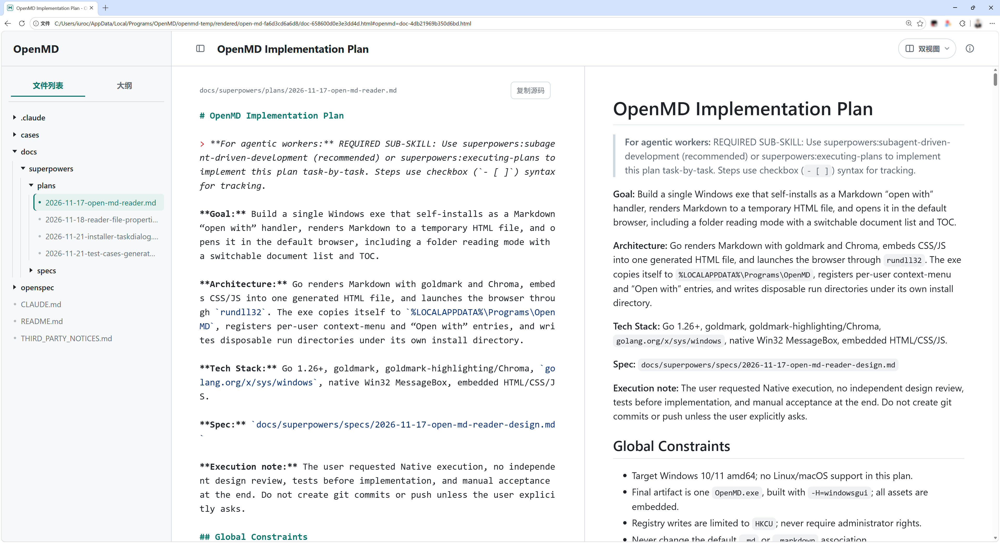
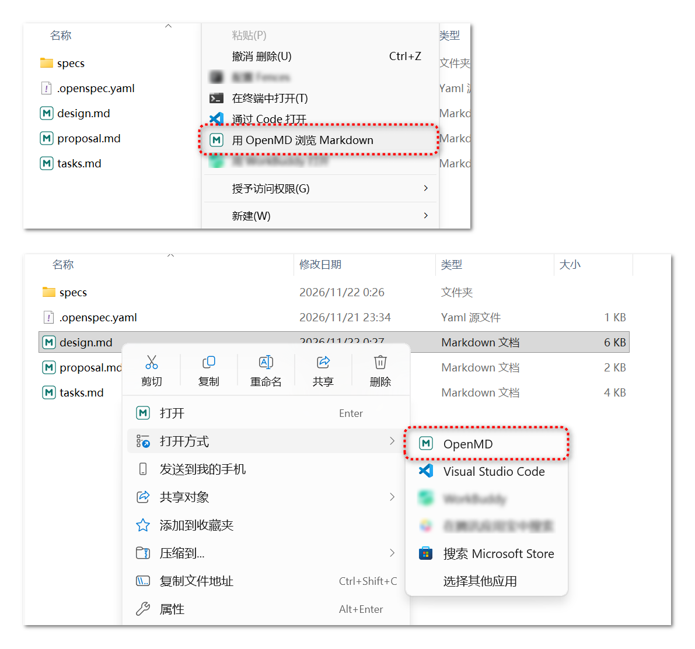
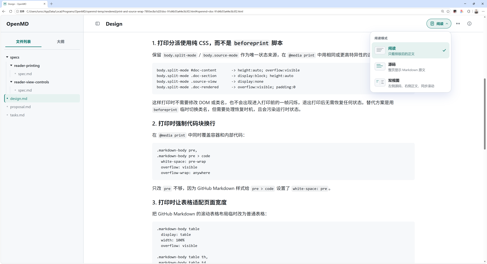
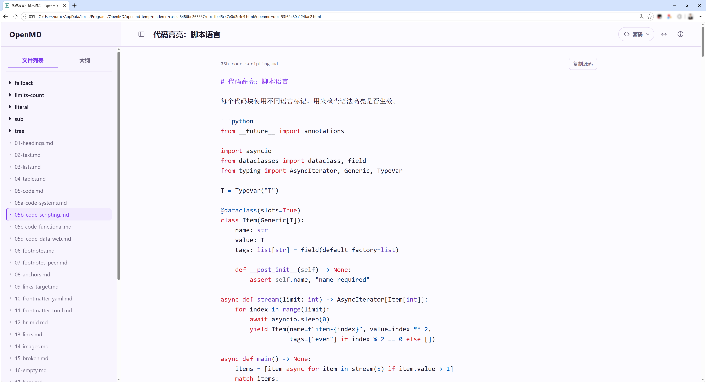

# OpenMD

> 不想为了读一个 `.md` 装一整套笔记软件？
> 右键打开，浏览器即读。一个只读、纯本地的 Windows Markdown 阅读器。

**约 10 MB 单 exe** · 自安装 · 无管理员权限 · 无 HTTP 服务 · 无后台进程

[下载最新版](../../releases/latest) · [30 秒上手](#30-秒上手) · [三种阅读模式](#三种阅读模式)



## 为什么是 OpenMD

- **真的轻**：单个 exe，约 10 MB，不需要额外运行时；关闭浏览器后没有后台进程。
- **真的本地**：本机渲染，不启动 HTTP 服务、不监听端口、不上传文档。
- **真的只读**：不建库、不导入、不锁定格式，你的 Markdown 仍是普通文件。
- **为阅读而做**：文件树、大纲、跨文档链接、阅读 / 源码 / 双视图。
- **打印不将就**：`Ctrl + P` 自动白底、代码块换行、表格适配页宽，直接得到可读 PDF。

OpenMD 不是编辑器，不是笔记库，也不是文档站生成器。它只做一件事：把你本地的 Markdown 读好。

## 30 秒上手

1. [下载最新版](../../releases/latest) `OpenMD.exe`
2. 双击安装，不需要管理员权限
3. 右键任意 `.md` 文件或文件夹，选择 OpenMD



*右键文件夹或 Markdown 文件，或从“打开方式”中选择 OpenMD。*

## 三种阅读模式

| 模式 | 适合 |
| --- | --- |
| 阅读 | 只看排版后的正文 |
| 源码 | 查看原始 Markdown，语法高亮、自动换行 |
| 双视图 | 左侧源码、右侧正文，两侧同步滚动 |



*顶栏的阅读模式菜单。*

双视图在窗口宽度不足 900px 时自动回退为阅读视图；顶栏的宽度按钮会隐藏，切回阅读 / 源码后恢复。通过文件树或跨文档链接打开另一篇时保持当前模式，刷新页面也会恢复上次选择。

### 源码视图



*Markdown 与围栏代码高亮，长行和超长单词自动折行。*

源码视图显示原始 Markdown，包括文档开头的 front matter，可一键复制完整源码。焦点在源码区域时，`Ctrl/Cmd + A` 只选中源码。

## 打印

- 阅读模式打印渲染正文，源码模式打印源码，双视图只打印渲染正文。
- 打印页面自动使用纯白底色，代码块和表格保留浅色背景。
- 代码块临时自动换行，表格适配页宽，不会出现横向滚动条或被裁切。
- 源码模式打印时隐藏工具栏，只打印源码正文。

## 更多能力

- 目录模式递归扫描，文件树按真实层级展开；根目录有 `README.md` / `index.md` 时优先打开。
- 单文件里的链接文档会生成独立页面，侧栏自动出现“文档”分组。
- 跨文档链接和中文标题锚点可直接跳转。
- 自动剥离 YAML / TOML front matter。
- 海盐蓝、松石、紫藤、石墨、宣纸五套配色，跟随系统明暗；滚动条同步使用当前配色。
- 正文字号、字体和字间距可调，只影响内容区域，代码保持等宽。
- 宽表格在正文中横向滚动，打印时自适应。
- 本地图片使用绝对 `file:///` 地址，不在 Markdown 文件旁生成任何文件。
- 内置 Markdown 使用手册：在「信息与设置 → 关于」里打开，从零学习常用写法。
- 无 HTTP 服务、无常驻后台进程、无浏览器内编辑。

## 更多使用细节

<details>
<summary>安装与卸载</summary>

双击 `OpenMD.exe` 即可安装到：

```text
%LOCALAPPDATA%\Programs\OpenMD\OpenMD.exe
```

安装完成后会弹出对话框；选择“完成”即可，需要卸载时在同一对话框选择“卸载”。下载目录里的原 exe 之后可以删除，右键菜单仍然可用。

不会修改 `.md` 的默认打开方式，只把它加入“打开方式”列表和右键菜单。

卸载会移除右键菜单、临时目录和安装副本。当前运行的安装副本由临时 helper 进程在退出后删除；极少数情况下需要重启后手动清理残留目录。也可以执行：

```bash
OpenMD.exe --uninstall
```

</details>

<details>
<summary>目录加载与快速模式</summary>

目录模式递归扫描所有子目录，并跳过 `.git`、`node_modules`、`vendor` 等目录，也不会跟随符号链接或 junction。默认不限制文档数量和总量；如果本次需要生成的文档超过 3,000 篇或 8 MiB，会先询问：

- 加载全部：取消数量、总量、深度、目录项和单文件限制；
- 快速模式：只加载 3,000 篇 / 8 MiB；
- 取消：不打开。

未变化文档会复用已有页面，只重建新增或修改的内容。单文件模式超过 32 MiB 时也会先询问。

</details>

<details>
<summary>文档间链接</summary>

- 文档里链接到本地 `.md` / `.markdown` 时，会生成目标文档的独立页面，点击后在同一标签页导航。
- 页内锚点 `[跳转](#章节)` 会定位到当前文档的对应标题；跨文档锚点 `[说明](other.md#章节)` 会打开目标页面并滚动到标题。
- 中文标题同样支持锚点，例如 `[说明](other.md#中文标题)`。
- 只跟随一层链接，最多 20 个链接文档，每个不超过 2 MB，总计不超过 10 MB。
- 链接文档在文件列表中用 `↗` 标记；目录模式中，扫描根之外的链接文档单独放在“链接文档”分组，不混入文件树。
- 本地相对路径优先按字面文件名解析；字面文件不存在时才尝试 URL 解码，因此 `100%.md`、`foo%bar.md` 这类文件名也能正常打开。
- 链接到网络路径（UNC 或映射网络盘）的文档不会在首屏预加载；点击时仍交给浏览器处理原始文件。
- 外部 `http(s)` 链接和本地非 Markdown 文件（PDF、图片等）默认在新标签页打开。

</details>

<details>
<summary>版本与更新</summary>

- 顶栏右侧的“信息与设置”面板分为“文件 / 设置 / 关于”三个 Tab。
- “文件”Tab 显示当前文档的完整路径和所在目录，并支持复制路径；“设置”Tab 提供配色、字体、字号和字间距；“关于”Tab 显示完整版本号、构建时间和发布页。
- “关于”Tab 中的发布页会打开 GitHub Releases；最新版本的构建时间晚于页面显示的构建时间，就说明有更新。
- 发布页链接只在正式构建的“关于”Tab 中出现；开发构建不会展示。
- 页面加载时不会访问 GitHub，也不做自动更新检查。

</details>

<details>
<summary>已知限制</summary>

- 只读，不支持浏览器内编辑或保存回原文件。
- Markdown 中的原始 HTML 不渲染，避免本地脚本注入。
- 超大目录首次打开需要预生成所有页面，确认“加载全部”后不受数量、总量、深度或目录项限制，但生成时间会随文档量增加。
- 快速模式仍受 3,000 篇 / 8 MiB 限制，并在文件树底部提示截断。
- 单文件超过 32 MiB 时会先询问，确认后读取。
- 本地链接优先按字面文件名解析；如果同时存在 `a%20b.md` 和 `a b.md`，会优先打开字面文件。
- 网络路径的 md 链接不会预渲染成阅读页，点击后由浏览器打开原始文件。
- 本地图片使用绝对路径。Chrome / Edge 正常；Firefox 的 `file://` 同源策略可能拦截跨目录图片。
- 远程 `http(s)` 图片保持原地址，离线时可能不显示。
- exe 未做代码签名，首次运行可能触发 SmartScreen 提示。
- 安装与错误对话框使用 Windows 原生 TaskDialog，不跟随阅读页配色和深色模式。
- 不做 PDF 导出、数学公式、Mermaid、文件监听或实时预览。

</details>

## 开发

构建、测试、发布和内部实现说明见 [AGENTS.md](AGENTS.md)。

正文样式使用 [github-markdown-css](https://github.com/sindresorhus/github-markdown-css)（MIT），许可声明见 `THIRD_PARTY_NOTICES.md`。

## License

本项目使用 [MIT](LICENSE) 许可证，Copyright (c) 2026 iuroc。
